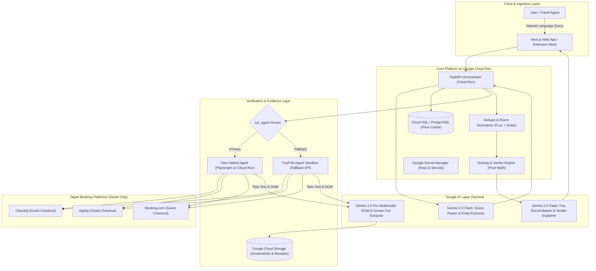

# TinyTravel — Startup Buildathon India 2026 Application

**Track:** Consumer AI & Enterprise Automation  
**Event:** Startup Buildathon India 2026 (Google AI, Google Cloud, Hack2skill)  
**Submission Date:** 14 Nov 2026  
**Status:** MVP Built & Reconciled (Phase 0/1 Verified)  

---

## 1. Idea & Executive Summary
TinyTravel is the autonomous, verified all-in price layer for hotel bookings. Today, travellers and travel agents waste hours opening 5+ browser tabs, only to discover at checkout that listed rates hide mandatory convenience fees, dynamic surges, and room-tier mismatches. Listing scrapers and meta-search engines fail because the true payable total exists only after walking through checkout forms. TinyTravel deploys autonomous guest agents that navigate booking checkouts (without ever paying or logging in), extract the final payable amount, reconcile fees, attach cryptographic proof (page text hash and screenshots), and normalize like-for-like options (same room, guests, meal plan, cancellation). 

---

## 2. Problem Statement
1. **Drip Pricing & Fee Leak:** Listed prices routinely hide mandatory convenience fees, local taxes, and payment gateway surcharges that appear only on the final payment screen.
2. **Asymmetric Room Comparisons:** Meta-search sites compare headline prices across sites that represent different room classes, bed types, breakfast inclusion, or non-refundable terms.
3. **Broken Automation:** Scrapers cannot retrieve final payable amounts behind dynamic SPAs, multi-step guest checkout forms, and coupon validation endpoints.

---

## 3. Solution & Product Architecture
TinyTravel operates in three layers:
- **The Face:** Instant search intake, side-by-side like-for-like verified comparisons, fee leak warnings, and deep-link handoff.
- **The Engine:** Autonomous guest verification agents (Playwright + Gemini recovery, TinyFish fallback), shared price cache with freshness timestamps, and SHA-256 signed evidence receipts.
- **Monetization (Hypothesis, Not Validated):** B2B subscriptions for travel agents and corporate desks needing audit-ready verified quotes; consumer affiliate handoff as free acquisition funnel.

### System Architecture Diagram

---

## 4. Empirical Evidence (Real Measured Probes)
TinyTravel does not rely on hypothetical savings. Every claim is tied to an auditable verification run:
- **Cleartrip Gate Run (n=1, run_id: `b90d7c92-f7b0-4034-ad2e-9cee8b8a6771`):**
  - **Property:** La Marvella, Bengaluru (20–21 Nov 2026, 2 adults).
  - **Listed Search Price:** ₹8,867
  - **Final Payment Payable:** ₹11,933 (**+34.6% fee leak**, +₹3,066 increase).
  - **Reconciled Fee Breakdown:** Base Room ₹15,639 + Taxes ₹1,971 − Property Discount ₹4,692 − Coupon (CTHOTEL) ₹2,080 + Convenience Fee ₹1,095 = **₹11,933** (Exact 100% reconciliation).
  - **Evidence Artifact:** `results/gate_la_marvella_cleartrip_raw.json`.
- **Cross-Platform Comparability Rule:** When comparing across platforms, like-for-like requires matching room tier AND cancellation policy. For example, La Marvella on Cleartrip (non-refundable: ₹11,495) vs Agoda (free cancellation: ₹15,175.27) are strictly **NOT COMPARABLE** due to cancellation policy divergence.
- **Autonomous Agent Spike:** Playwright headless agent spike across 5 properties measured 0/5 verified (median 7.0s), blocked by Cleartrip client-side SPA dynamic search input requirement, demonstrating why multimodal vision/DOM agents (Gemini + TinyFish fallback) are necessary.

---

## 5. Startup Buildathon Judging Alignment
*Official 5 evaluation pillars quoted from startupbuildathon.com: "Founder Profile, Product Potential, Market Viability, Technical Architecture, Use of Google AI & Cloud". (Pre-built code restriction clause: NOT FOUND on official site).*

| Judging Pillar | TinyTravel Alignment |
|---|---|
| **Founder Profile** | Domain experience in autonomous web agents, price scraping, and enterprise API engineering. |
| **Product Potential** | Solves high-friction drip pricing and fee leaks with cryptographic proof receipts. |
| **Market Viability** | Double-sided model: high-margin B2B subscription for travel agents + consumer affiliate acquisition. |
| **Technical Architecture** | Pure mathematical scoring engine, multi-stage Docker container, Knative Cloud Run deployment. |
| **Google AI & Cloud** | Gemini 2.5 Flash query intake, Gemini 2.5 Pro multimodal DOM extractor, Cloud Run, Cloud SQL, Secret Manager. |

---

## 6. Technology Stack & Google Cloud Alignment
| Component | Implementation | Google Technology Used |
|---|---|---|
| Query Intake | Multilingual semantic stay parser | **Google Gemini 2.5 Flash** |
| Page Understanding | Autonomous fee extraction from payment DOM | **Google Gemini 2.5 Pro (Multimodal)** |
| API Orchestration | Asynchronous FastAPI service | **Google Cloud Run** |
| Task Scheduling | Freshness polling & cache invalidation | **Google Cloud Tasks / Cloud Scheduler** |
| Persistence | Verified price database & audit trails | **Google Cloud SQL (PostgreSQL)** |
| Evidence Storage | Raw page texts, hashes, and screenshots | **Google Cloud Storage** |
| Secrets & Security | API keys and signing keys | **Google Secret Manager** |

---

## 7. Safety & Operating Invariants
1. **Guest Only:** Dummy details (`Test Guest`, `test.guest+probe@example.com`, `9000000000`).
2. **Hard Payment Stop:** Agents stop unconditionally at the payment screen. Zero payment processing, zero OTP entry, zero card data stored.
3. **No Hallucinated Numbers:** Unverified runs are displayed as `null` / N/A. Every verified price requires an immutable SHA-256 hash or evidence file.
